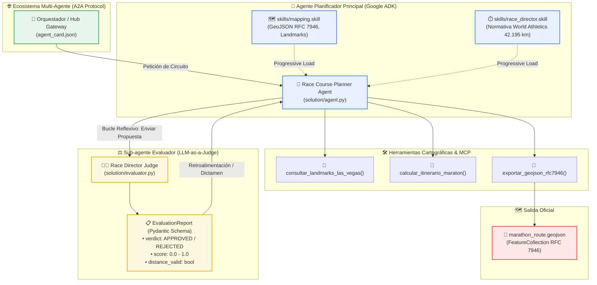

# 🏃 Cloud Runner 2049: Simulación Multi-Agente con Google ADK, Remote MCP y A2A

> **⚡ Powered by aaronthewarrior**  
> Repositorio base, adaptación práctica para comunidades y curaduría técnica creada por [aaronthewarrior](https://github.com/aaron-the-warrior).

[](https://github.com/aaron-the-warrior)
[](https://adk.dev/)
[](https://aistudio.google.com/)
[](https://www.python.org/)
[](https://a2a-protocol.org/)
[](https://modelcontextprotocol.io/)
[](#-prerrequisitos-y-configuración-del-entorno)
[](#-prerrequisitos-y-configuración-del-entorno)

Guía completa y taller práctico paso a paso para aprender a diseñar, orquestar y validar sistemas multi-agente avanzados en Python utilizando el **Agent Development Kit (ADK)** de Google, directivas modulares con **Progressive Disclosure (`.skill`)**, integración cartográfica desacoplada con **Model Context Protocol (Remote MCP)**, evaluación reflexiva e imparcial con **LLM-as-a-Judge** y comunicación estándar entre agentes mediante el protocolo **Agent-to-Agent (A2A)**.

El taller está inspirado en la demostración central de Google Cloud Next: [Race Condition (Las Vegas Marathon Multi-Agent Simulation)](https://github.com/GoogleCloudPlatform/race-condition).

> [!TIP]
> El proyecto completo del taller se encuentra en la carpeta [`cloud-runner-2049-workshop`](file:///C:/Users/aaron/Documents/GDE/Workshops/cloud_runner_2049/cloud-runner-2049-workshop). Para comenzar de inmediato, consulta la [Documentación Completa del Taller](file:///C:/Users/aaron/Documents/GDE/Workshops/cloud_runner_2049/cloud-runner-2049-workshop/README.md).

---

## 📑 Temario

 1. [Créditos y Cita de la Fuente Original](#️-créditos-y-cita-de-la-fuente-original)
 2. [Conceptos Clave del Taller](#-conceptos-clave-del-taller)
 3. [Arquitectura del Sistema Multi-Agente](#️-arquitectura-del-sistema-multi-agente)
 4. [Estructura del Directorio](#-estructura-del-directorio)
 5. [Prerrequisitos y Configuración del Entorno](#-prerrequisitos-y-configuración-del-entorno)
 6. [Índice de Laboratorios Prácticos](#-índice-de-laboratorios-prácticos)
 7. [Paso a Paso de los Laboratorios](#-paso-a-paso-de-los-laboratorios)
 8. [Ejecución y Verificación en Vivo](#-ejecución-y-verificación-en-vivo)
 9. [Inspección Visual con ADK Web y CLI](#-inspección-visual-con-adk-web-y-cli)
10. [Compatibilidad con Modelos: Gemini 4 vs Gemini 3.1](#-compatibilidad-con-modelos-gemini-4-vs-gemini-31)
11. [Solución de Problemas Frecuentes (FAQ / Troubleshooting)](#-solución-de-problemas-frecuentes-faq--troubleshooting)
12. [Recursos para Seguir Aprendiendo](#-recursos-para-seguir-aprendiendo)

---

## 🎖️ Créditos y Cita de la Fuente Original

Este repositorio y material didáctico es un proyecto **Powered by [aaronthewarrior](https://github.com/aaron-the-warrior)**, creado para estructurar, traducir y llevar al plano práctico los conceptos presentados en las fuentes oficiales de Google:

* **Autor y Curador de esta adaptación:**
  * **Aarón Guerrero**

    **Enlaces:**
    - [](https://me.developers.google.com/u/108177037637693690075)
    - [](https://github.com/aaron-the-warrior)
    - [](https://www.linkedin.com/in/aaronthewarrior/)
    - [](https://twitter.com/aaronthewarrior)
    - [](https://www.facebook.com/aaron.guerrero.hernandez)

* **Demostración Oficial de Google Cloud Next:**
  * *Título:* **Race Condition: Las Vegas Marathon Multi-Agent Simulation**
  * *Organización:* Google Cloud Platform / Google Developers
  * *Repositorio Oficial:* [https://github.com/GoogleCloudPlatform/race-condition](https://github.com/GoogleCloudPlatform/race-condition)
  * *Portal de Soluciones:* [https://developers.google.com/solutions/learn/race-condition](https://developers.google.com/solutions/learn/race-condition)

* **Documentación Oficial de Google ADK:**
  * *Portal Principal:* [https://adk.dev/](https://adk.dev/)
  * *Python Quickstart:* [https://adk.dev/get-started/python/](https://adk.dev/get-started/python/)

* **Estándar Abierto Agent-to-Agent (A2A):**
  * *Especificación:* [https://a2a-protocol.org/](https://a2a-protocol.org/)

---

## 💡 Conceptos Clave del Taller

1. **Google Agent Development Kit (ADK 2.12+):** Clases `Agent`, herramientas tipadas en Python y arquitectura agéntica estándar.
2. **Progressive Disclosure with Skills (`.skill`):** Carga dinámica de directivas operativas bajo demanda para evitar saturación de contexto.
3. **Model Context Protocol (Remote MCP):** Integración desacoplada con herramientas cartográficas de Google Maps y GeoJSON RFC 7946.
4. **LLM-as-a-Judge con Ventana Acotada:** Sub-agente evaluador en turno aislado para mitigar *agent drift* y sesgos de complacencia.
5. **Agent-to-Agent Protocol (A2A):** Manifiesto `Agent Card` para descubrimiento e interoperabilidad entre agentes.

---

## 🏛️ Arquitectura del Sistema Multi-Agente



---

## 🗂️ Estructura del Directorio

```text
cloud_runner_2049/
├── README.md                                  # Guía principal del workshop
├── prompt_maestro_para_agy.md                 # Prompt de generación y arquitectura
└── cloud-runner-2049-workshop/                # Repositorio práctico del taller
    ├── .env.example                           # Variables de entorno de ejemplo
    ├── pyproject.toml                         # Especificación uv y dependencias
    ├── README.md                              # Manual de laboratorio paso a paso
    ├── scripts/
    │   ├── setup.ps1                          # Automatización en PowerShell (Windows)
    │   └── setup.sh                           # Automatización en Bash (Linux/macOS)
    ├── skills/
    │   ├── mapping.skill                      # Directivas cartográficas RFC 7946
    │   └── race_director.skill                # Normativa World Athletics (42.195 km)
    ├── labs/
    │   ├── 01-adk-planner-skills.md           # Lab 1: ADK y carga progresiva de Skills
    │   ├── 02-remote-mcp-maps.md              # Lab 2: MCP y exportación GeoJSON
    │   ├── 03-evaluator-subagent.md           # Lab 3: LLM-as-a-Judge y bucle reflexivo
    │   └── 04-a2a-orchestration.md            # Lab 4: Manifiesto Agent Card y A2A
    ├── starter/                               # Código esqueleto para participantes
    │   ├── agent.py                           # Esqueleto del agente planificador
    │   ├── evaluator.py                       # Esqueleto del sub-agente evaluador
    │   └── agent_card.json                    # Esqueleto del contrato A2A
    └── solution/                              # Solución completa y verificada
        ├── agent.py                           # Planificador completo
        ├── evaluator.py                       # Evaluador completo
        ├── agent_card.json                    # Manifiesto A2A listo
        └── marathon_route.geojson             # GeoJSON generado con el trazado oficial
```

---

## ⚙️ Prerrequisitos y Configuración del Entorno

### 1. Requisitos del Sistema
* **Python:** Versión 3.11 o superior instalada.
* **Git:** Para clonar el repositorio.
* **Gestor de paquetes:** [`uv`](https://docs.astral.sh/uv/) o `pip`.
* **API Key de Gemini:** Obtenida en [Google AI Studio](https://aistudio.google.com/apikey) o cuenta en Google Cloud Vertex AI.

---

### 2. Instalación Rápida

#### En Windows (PowerShell):
```powershell
cd C:\Users\aaron\Documents\GDE\Workshops\cloud_runner_2049\cloud-runner-2049-workshop
.\scripts\setup.ps1
```

#### En Linux / macOS / Google Cloud Shell (Bash):
```bash
cd cloud_runner_2049/cloud-runner-2049-workshop
chmod +x ./scripts/setup.sh
./scripts/setup.sh
```

---

## 📚 Índice de Laboratorios Prácticos

| Laboratorio | Título | Enfoque Principal |
| :---: | :--- | :--- |
| **Lab 01** | **Google ADK & Progressive Skills** | [01-adk-planner-skills.md](file:///C:/Users/aaron/Documents/GDE/Workshops/cloud_runner_2049/cloud-runner-2049-workshop/labs/01-adk-planner-skills.md) |
| **Lab 02** | **Remote MCP & Cartografía GeoJSON** | [02-remote-mcp-maps.md](file:///C:/Users/aaron/Documents/GDE/Workshops/cloud_runner_2049/cloud-runner-2049-workshop/labs/02-remote-mcp-maps.md) |
| **Lab 03** | **LLM-as-a-Judge & Agent Drift** | [03-evaluator-subagent.md](file:///C:/Users/aaron/Documents/GDE/Workshops/cloud_runner_2049/cloud-runner-2049-workshop/labs/03-evaluator-subagent.md) |
| **Lab 04** | **Orquestación A2A & Agent Card** | [04-a2a-orchestration.md](file:///C:/Users/aaron/Documents/GDE/Workshops/cloud_runner_2049/cloud-runner-2049-workshop/labs/04-a2a-orchestration.md) |

---

## 🚀 Ejecución y Verificación en Vivo

```powershell
# Accede al directorio del taller
cd C:\Users\aaron\Documents\GDE\Workshops\cloud_runner_2049\cloud-runner-2049-workshop

# 1. Probar el sub-agente evaluador
python solution/evaluator.py

# 2. Ejecutar la solución completa del planificador
python solution/agent.py
```

El planificador diseñará el circuito, validará los 42.195 km con el juez de carrera y exportará el circuito en [`solution/marathon_route.geojson`](file:///C:/Users/aaron/Documents/GDE/Workshops/cloud_runner_2049/cloud-runner-2049-workshop/solution/marathon_route.geojson) listo para ser visualizado en [geojson.io](https://geojson.io).

---

## 📚 Recursos para Seguir Aprendiendo

- [Google Agent Development Kit (ADK) - Documentación Oficial](https://adk.dev/)
- [Google Cloud Next '26 - Race Condition Demo Repository](https://github.com/GoogleCloudPlatform/race-condition)
- [Agent-to-Agent (A2A) Protocol Specification](https://a2a-protocol.org/)
- [Model Context Protocol (MCP) Official Documentation](https://modelcontextprotocol.io/)
- [Google AI Studio - Obtener API Keys](https://aistudio.google.com/)
