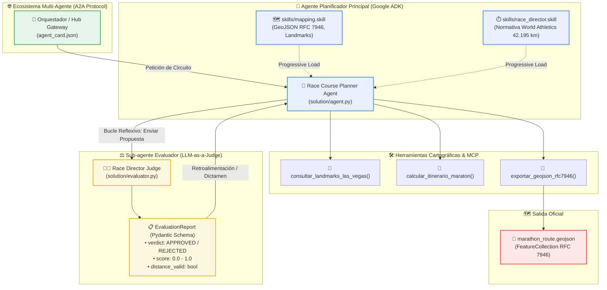

# 🏃 Cloud Runner 2049: Simulación Multi-Agente con Google ADK, Remote MCP y A2A

> **⚡ Powered by aaronthewarrior**  
> Repositorio base, adaptación práctica para comunidades y curaduría técnica creada por [aaronthewarrior](https://github.com/aaron-the-warrior).

[](https://github.com/aaron-the-warrior)
[](https://adk.dev/)
[](https://aistudio.google.com/)
[](https://www.python.org/)
[](https://a2a-protocol.org/)
[](https://modelcontextprotocol.io/)
[](#-prerrequisitos-y-configuración-del-entorno)
[](#-prerrequisitos-y-configuración-del-entorno)

Guía completa y taller práctico paso a paso para aprender a diseñar, orquestar y validar sistemas multi-agente avanzados en Python utilizando el **Agent Development Kit (ADK)** de Google, directivas modulares con **Progressive Disclosure (`.skill`)**, integración cartográfica desacoplada con **Model Context Protocol (Remote MCP)**, evaluación reflexiva e imparcial con **LLM-as-a-Judge** y comunicación estándar entre agentes mediante el protocolo **Agent-to-Agent (A2A)**.

El taller está inspirado en la demostración central de Google Cloud Next: [Race Condition (Las Vegas Marathon Multi-Agent Simulation)](https://github.com/GoogleCloudPlatform/race-condition).

> [!TIP]
> El taller está optimizado para ejecutarse en **Windows PowerShell** o en **Linux / macOS (Bash)**. Toda la base de código, documentación técnica, habilidades y salidas de consola están localizadas 100% en **español**.

---

## 📑 Temario

 1. [Créditos y Cita de la Fuente Original](#️-créditos-y-cita-de-la-fuente-original)
 2. [Conceptos Clave del Taller](#-conceptos-clave-del-taller)
 3. [Arquitectura del Sistema Multi-Agente](#️-arquitectura-del-sistema-multi-agente)
 4. [Estructura del Repositorio](#-estructura-del-repositorio)
 5. [Prerrequisitos y Configuración del Entorno](#-prerrequisitos-y-configuración-del-entorno)
 6. [Índice de Laboratorios Prácticos](#-índice-de-laboratorios-prácticos)
 7. [Paso a Paso de los Laboratorios](#-paso-a-paso-de-los-laboratorios)
    - [Lab 01: Inicialización con ADK y Progressive Skills](#lab-01-inicialización-con-adk-y-progressive-skills)
    - [Lab 02: Remote MCP y Cartografía GeoJSON RFC 7946](#lab-02-remote-mcp-y-cartografía-geojson-rfc-7946)
    - [Lab 03: LLM-as-a-Judge y Mitigación de Agent Drift](#lab-03-llm-as-a-judge-y-mitigación-de-agent-drift)
    - [Lab 04: Manifiesto Agent Card y Orquestación A2A](#lab-04-manifiesto-agent-card-y-orquestación-a2a)
 8. [Ejecución y Verificación en Vivo](#-ejecución-y-verificación-en-vivo)
 9. [Inspección Visual con ADK Web y CLI](#-inspección-visual-con-adk-web-y-cli)
10. [Compatibilidad de Modelos: Gemini 4 (gemini-4-argon)](#-compatibilidad-de-modelos-gemini-4-gemini-4-argon)
11. [Solución de Problemas Frecuentes (FAQ / Troubleshooting)](#-solución-de-problemas-frecuentes-faq--troubleshooting)
12. [Recursos para Seguir Aprendiendo](#-recursos-para-seguir-aprendiendo)

---

## 🎖️ Créditos y Cita de la Fuente Original

Este repositorio y material didáctico es un proyecto **Powered by [aaronthewarrior](https://github.com/aaron-the-warrior)**, creado para estructurar, traducir y llevar al plano práctico los conceptos presentados en las fuentes oficiales de Google:

* **Autor y Curador de esta adaptación:**
  * **Aarón Guerrero**

    **Enlaces:**
    - [](https://me.developers.google.com/u/108177037637693690075)
    - [](https://github.com/aaron-the-warrior)
    - [](https://www.linkedin.com/in/aaronthewarrior/)
    - [](https://twitter.com/aaronthewarrior)
    - [](https://www.facebook.com/aaron.guerrero.hernandez)

* **Demostración Oficial de Google Cloud Next:**
  * *Título:* **Race Condition: Las Vegas Marathon Multi-Agent Simulation**
  * *Organización:* Google Cloud Platform / Google Developers
  * *Repositorio Oficial:* [https://github.com/GoogleCloudPlatform/race-condition](https://github.com/GoogleCloudPlatform/race-condition)
  * *Portal de Soluciones:* [https://developers.google.com/solutions/learn/race-condition](https://developers.google.com/solutions/learn/race-condition)

* **Documentación Oficial de Google ADK:**
  * *Portal Principal:* [https://adk.dev/](https://adk.dev/)
  * *Python Quickstart:* [https://adk.dev/get-started/python/](https://adk.dev/get-started/python/)

* **Estándar Abierto Agent-to-Agent (A2A):**
  * *Especificación:* [https://a2a-protocol.org/](https://a2a-protocol.org/)

---

## 💡 Conceptos Clave del Taller

En este taller implementarás cinco pilares de la ingeniería de software agéntica moderna:

1. **Google Agent Development Kit (ADK 2.12+):**
   A diferencia de frameworks basados en encadenamiento arbitrario de texto, ADK trata a los agentes como componentes de software de primera clase: clases `Agent`, herramientas tipadas en Python, sesiones deterministas y compatibilidad con `root_agent` para CLI e interfaz web.

2. **Divulgación Progresiva de Contexto (*Progressive Disclosure with Skills*):**
   Para evitar saturar la ventana de contexto del LLM (*context pollution*), el agente no recibe cientos de líneas de normativas en su prompt inicial. En su lugar, carga dinámicamente archivos `.skill` con frontmatter YAML bajo demanda (ej. directivas cartográficas o reglas de atletismo).

3. **Herramientas Desacopladas con Model Context Protocol (Remote MCP):**
   Las herramientas de cálculo de itinerario y cartografía de Las Vegas se exponen mediante el estándar abierto MCP, permitiendo que cualquier agente consuma servicios externos de manera uniforme.

4. **Patrón LLM-as-a-Judge con Ventana de Contexto Acotada:**
   Un problema crítico en agentes autónomos complejos es el *agent drift* (deriva de objetivos) y el sesgo de complacencia cuando un agente se evalúa a sí mismo. Aquí desacoplamos la validación en un **sub-agente juez** independiente que ejecuta cada evaluación en un turno aislado (*isolated turn*), forzando una respuesta tipada con Pydantic.

5. **Interoperabilidad Multi-Agente con Agent-to-Agent (A2A):**
   El agente publica su contrato de capacidades mediante un manifiesto `agent_card.json`, permitiendo que orquestadores externos o hubs descubran sus endpoints, habilidades y esquemas de entrada/salida.

---

## 🏛️ Arquitectura del Sistema Multi-Agente



---

## 🗂️ Estructura del Repositorio

```text
cloud-runner-2049-workshop/
├── .env.example                     # Plantilla de variables de entorno (.env)
├── pyproject.toml                   # Especificación de proyecto compatible con uv / pip
├── README.md                        # Documentación maestra del taller
├── scripts/
│   ├── setup.ps1                    # Script automatizado para Windows (PowerShell)
│   └── setup.sh                     # Script automatizado para Linux / macOS / Cloud Shell (Bash)
├── skills/
│   ├── mapping.skill                # Habilidad: Directivas cartográficas RFC 7946 y coordenadas [lon, lat]
│   └── race_director.skill          # Habilidad: Reglas World Athletics (42.195 km, puestos de agua, meta)
├── labs/
│   ├── 01-adk-planner-skills.md     # Laboratorio 1: Inicialización con ADK y carga de Skills
│   ├── 02-remote-mcp-maps.md        # Laboratorio 2: Herramientas cartográficas y exportación GeoJSON
│   ├── 03-evaluator-subagent.md     # Laboratorio 3: LLM-as-a-Judge, aislamiento y bucle reflexivo
│   └── 04-a2a-orchestration.md      # Laboratorio 4: Manifiesto Agent Card y orquestación A2A
├── starter/                         # Código esqueleto para participantes (contiene # TODO)
│   ├── agent.py                     # Esqueleto del agente planificador
│   ├── evaluator.py                 # Esqueleto del sub-agente evaluador
│   └── agent_card.json              # Esqueleto del manifiesto A2A
└── solution/                        # Solución completa y verificada de referencia
    ├── agent.py                     # Implementación completa del planificador
    ├── evaluator.py                 # Implementación completa del evaluador
    ├── agent_card.json              # Manifiesto A2A listo para producción
    └── marathon_route.geojson       # Trazado oficial de 42.195 km generado por el agente
```

---

## ⚙️ Prerrequisitos y Configuración del Entorno

### 1. Requisitos del Sistema
* **Python:** Versión 3.11 o superior instalada.
* **Git:** Para clonar el repositorio.
* **Gestor de paquetes:** [`uv`](https://docs.astral.sh/uv/) (recomendado por velocidad) o `pip`.
* **API Key de Gemini:** Clave gratuita obtenida en [Google AI Studio](https://aistudio.google.com/apikey) o credenciales de Google Cloud / Vertex AI.

---

### 2. Instalación Rápida con Scripts Automatizados

#### En Windows (PowerShell):
```powershell
# 1. Clonar y acceder a la carpeta del taller
cd C:\Users\aaron\Documents\GDE\Workshops\cloud_runner_2049\cloud-runner-2049-workshop

# 2. Ejecutar el script automatizado
.\scripts\setup.ps1
```

#### En Linux / macOS / Google Cloud Shell (Bash):
```bash
# 1. Acceder al directorio
cd cloud_runner_2049/cloud-runner-2049-workshop

# 2. Asignar permisos y ejecutar
chmod +x ./scripts/setup.sh
./scripts/setup.sh
```

El script de instalación se encarga automáticamente de:
1. Crear el entorno virtual `.venv` con Python 3.11+.
2. Instalar todas las dependencias del proyecto (`google-adk`, `google-genai`, `mcp`, `pydantic`, `geojson`, `python-dotenv`).
3. Generar el archivo `.env` a partir de `.env.example`.

---

### 3. Configuración de Variables de Entorno (`.env`)

Abre el archivo `.env` en la raíz del proyecto y configura tus credenciales:

```bash
# ==============================================================================
# Variables de Entorno - Cloud Runner 2049
# ==============================================================================

# Clave de API de Google GenAI (AI Studio o Vertex AI)
GOOGLE_API_KEY="AIzaSyTuClaveDeGoogleAIStudio..."

# Modelo a utilizar con Google ADK (Gemini 4 por defecto)
ADK_MODEL="gemini-4-argon"

# Desactivar Vertex AI para usar la API directa de Google AI Studio
GOOGLE_GENAI_USE_VERTEXAI="FALSE"
```

> [!NOTE]
> El modelo configurado por defecto es `gemini-4-argon` (Gemini 4). Además, el código incorpora respaldo resiliente automático hacia `gemini-3.1-flash-lite` para permitir la ejecución fluida en cuentas de nivel gratuito (*free-tier*) con cuota cero en modelos preliminares.

---

## 📚 Índice de Laboratorios Prácticos

| Laboratorio | Título | Enfoque Principal | Guía Detallada |
| :---: | :--- | :--- | :---: |
| **Lab 01** | **Google ADK & Progressive Skills** | Declaración de `Agent`, convención `root_agent` y carga dinámica de `.skill`. | [01-adk-planner-skills.md](file:///C:/Users/aaron/Documents/GDE/Workshops/cloud_runner_2049/cloud-runner-2049-workshop/labs/01-adk-planner-skills.md) |
| **Lab 02** | **Remote MCP & Cartografía GeoJSON** | Herramientas cartográficas de Las Vegas y exportación GeoJSON RFC 7946 con coordenadas `[lon, lat]`. | [02-remote-mcp-maps.md](file:///C:/Users/aaron/Documents/GDE/Workshops/cloud_runner_2049/cloud-runner-2049-workshop/labs/02-remote-mcp-maps.md) |
| **Lab 03** | **LLM-as-a-Judge & Agent Drift** | Creación del sub-agente evaluador en contexto acotado, validación con Pydantic y bucle de reflexión. | [03-evaluator-subagent.md](file:///C:/Users/aaron/Documents/GDE/Workshops/cloud_runner_2049/cloud-runner-2049-workshop/labs/03-evaluator-subagent.md) |
| **Lab 04** | **Orquestación A2A & Agent Card** | Publicación del contrato de capacidades `Agent Card` y orquestación inter-agente. | [04-a2a-orchestration.md](file:///C:/Users/aaron/Documents/GDE/Workshops/cloud_runner_2049/cloud-runner-2049-workshop/labs/04-a2a-orchestration.md) |

---

## 🧪 Paso a Paso de los Laboratorios

### Lab 01: Inicialización con ADK y Progressive Skills
En este laboratorio aprenderás cómo estructurar un agente profesional con **Google ADK**:
- Separación de instrucciones generales e instrucciones especializadas.
- Lectura de directivas operativas desde `skills/mapping.skill` y `skills/race_director.skill`.
- Configuración de `root_agent` para compatibilidad nativa con la CLI de ADK.

### Lab 02: Remote MCP y Cartografía GeoJSON RFC 7946
En este laboratorio dotarás al agente de capacidades espaciales:
- Implementación de herramientas nativas de Python: `consultar_landmarks_las_vegas` y `calcular_itinerario_maraton`.
- Aplicación estricta de la norma **RFC 7946**: orden `[longitud, latitud]` para evitar errores comunes de inversión geográfica.
- Generación y serialización de una `FeatureCollection` con la línea de carrera (`LineString`) y puestos de apoyo (`Point`).

### Lab 03: LLM-as-a-Judge y Mitigación de Agent Drift
En este laboratorio construirás el mecanismo de supervisión autónoma:
- Creación de un sub-agente juez (`race_director_judge`) con contexto acotado.
- Definición de esquema tipado con **Pydantic** (`EvaluationReport`) que exige `APPROVED` o `REJECTED`, puntaje de 0.0 a 1.0 y lista de violaciones.
- Implementación del **bucle de reflexión**: el planificador envía su trazado al evaluador antes de responder al usuario; si el juez detecta que faltan puestos de agua o la distancia no es de 42.195 km, el planificador ajusta el trazado hasta ser aprobado.

### Lab 04: Manifiesto Agent Card y Orquestación A2A
En este laboratorio conectarás tu agente con el ecosistema global de agentes:
- Estructuración de `agent_card.json` según el estándar de **Agent-to-Agent (A2A)**.
- Publicación de metadatos, versiones, endpoints HTTP y esquemas JSON Schema de entrada y salida.
- Simulación de interoperabilidad entre un orquestador central y agentes especializados.

---

## 🚀 Ejecución y Verificación en Vivo

El proyecto incluye tanto el código esqueleto para estudiantes (`starter/`) como la solución completa de referencia (`solution/`).

### 1. Probar el Sub-agente Evaluador (LLM-as-a-Judge)
Verifica que el juez de carrera evalúe una propuesta y devuelva el dictamen tipado en JSON:

```powershell
# En Windows PowerShell
python solution/evaluator.py

# En Linux / macOS
python3 solution/evaluator.py
```

**Salida esperada:**
```text
============================================================
🧪 Evaluando sub-agente LLM-as-a-Judge (Race Director)
============================================================

🔍 Enviando propuesta de prueba al modelo...

📊 Dictamen: APPROVED
🎯 Puntaje de cumplimiento: 100.0%
📏 Distancia detectada: 42.195 km (Válida: True)
💧 Hidratación válida: True
🏁 Meta segura: True
📝 Resumen: La propuesta cumple estrictamente con los estándares de distancia reglamentaria, cadencia de hidratación, zonas de salida/meta y despliegue de asistencia médica exigidos para el maratón Cloud Runner 2049.
```

---

### 2. Probar el Agente Planificador Autónomo
Ejecuta el ciclo agéntico completo (consulta de hitos, trazado de 42.195 km, validación con el juez y exportación del GeoJSON):

```powershell
# En Windows PowerShell
python solution/agent.py

# En Linux / macOS
python3 solution/agent.py
```

Al finalizar la ejecución, el agente habrá generado el archivo:
```text
solution/marathon_route.geojson
```

---

### 3. Visualizar el Recorrido Oficial en un Mapa Interactivo
Puedes inspeccionar visualmente el archivo generado por el agente en cualquier visor GeoJSON:
1. Abre tu navegador y accede a [geojson.io](https://geojson.io/).
2. Haz clic en **Open** > **File** y selecciona el archivo `solution/marathon_route.geojson`.
3. Verás el trazado completo comenzando en el emblemático *Welcome to Fabulous Las Vegas Sign*, recorriendo The Strip, pasando por The Sphere y el Arts District, y culminando con el embudo de seguridad en *Fremont Street Experience*.

---

## 💻 Inspección Visual con ADK Web y CLI

Google ADK incluye herramientas de depuración avanzadas para inspeccionar el razonamiento del agente, la invocación de herramientas y el flujo de mensajes:

### Ejecución en Modo Consola Interactiva (`adk run`)
```powershell
adk run solution
```

Podrás dialogar directamente con el agente y observar cómo consulta las herramientas en tiempo real.

### Servidor de Inspección Visual (`adk web`)
```powershell
adk web
```
Abre tu navegador en `http://localhost:8000` para acceder a la interfaz gráfica de ADK, donde verás:
- La línea de tiempo de eventos y llamadas a herramientas (*tool calling timeline*).
- Los argumentos parseados enviados al sub-agente evaluador.
- La traza completa de tokens y tiempos de respuesta.

---

## 🤖 Compatibilidad de Modelos: Gemini 4 (gemini-4-argon)

El taller está configurado para operar con **Gemini 4** a través de Google ADK y la API de Google GenAI:

| Modelo | Identificador en API | Estado y Uso en el Taller |
| :--- | :--- | :--- |
| **Gemini 4** | `gemini-4-argon` | **Modelo oficial del taller.** Última generación de razonamiento multimodal y ejecución de herramientas de Google. |
| **Gemini 3.1 Flash Lite** | `gemini-3.1-flash-lite` | **Respaldo resiliente automático.** Activado transparentemente por el runner si la cuenta utilizada no dispone de cuota asignada para Gemini 4. |
| **Gemini 3.8 Flash** | `gemini-3.8-flash` | Modelo de vista previa alternativo. |

Para seleccionar el modelo explícitamente, puedes definir la variable `ADK_MODEL` en tu archivo [.env](file:///C:/Users/aaron/Documents/GDE/Workshops/cloud_runner_2049/cloud-runner-2049-workshop/.env):
```bash
ADK_MODEL="gemini-4-argon"
```

---

## ❓ Solución de Problemas Frecuentes (FAQ / Troubleshooting)

### 1. Error `503 UNAVAILABLE - High demand spike`
- **Causa:** La API de Google GenAI puede presentar picos transitorios de demanda bajo concurrencia masiva.
- **Solución implementada:** Todo el código del taller cuenta con un bucle de reintento automático con *exponential backoff* en `ejecutar_agente_adk`, garantizando que el sistema reintente la llamada de forma transparente.

### 2. Error `429 RESOURCE_EXHAUSTED` al usar Gemini 4
- **Causa:** El mensaje indica: `Quota exceeded for metric ... limit: 0, model: gemini-4-argon`. Tu cuenta o API key actual está en el nivel gratuito y Google aún no habilita cuota para Gemini 4 en dicho nivel.
- **Solución:** Mantén `ADK_MODEL="gemini-3.1-flash-lite"` en el archivo `.env`, el cual está plenamente habilitado y validado para todos los ejercicios.

### 3. Error de codificación en consolas Windows (`cp1252` / `UnicodeEncodeError`)
- **Causa:** La consola estándar de Windows usa codificaciones legadas que fallan ante emojis o acentos en español.
- **Solución implementada:** Los scripts incluyen la configuración automática `sys.stdout.reconfigure(encoding="utf-8")`. Además, en PowerShell puedes ejecutar:
  ```powershell
  [Console]::OutputEncoding = [System.Text.Encoding]::UTF8
  ```

### 4. Coordenadas GeoJSON invertidas en el mapa
- **Causa:** Muchas librerías usan `[latitud, longitud]`, pero el estándar oficial **RFC 7946** exige obligatoriamente `[longitud, latitud]`.
- **Solución:** Verifica que el primer valor sea la longitud (negativa en Las Vegas, ej. `-115.1728`) y el segundo sea la latitud (positiva, ej. `36.0820`).

---

## 📚 Recursos para Seguir Aprendiendo

- [Google Agent Development Kit (ADK) - Documentación Oficial](https://adk.dev/)
- [Google Cloud Next '26 - Race Condition Demo Repository](https://github.com/GoogleCloudPlatform/race-condition)
- [Agent-to-Agent (A2A) Protocol Specification](https://a2a-protocol.org/)
- [Model Context Protocol (MCP) Official Documentation](https://modelcontextprotocol.io/)
- [GeoJSON RFC 7946 Standard Specification](https://datatracker.ietf.org/doc/html/rfc7946)
- [Google AI Studio - Obtener API Keys](https://aistudio.google.com/)
